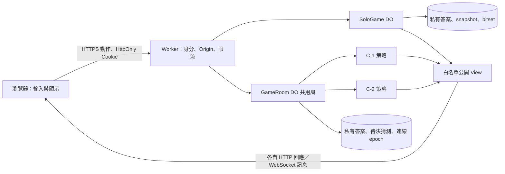
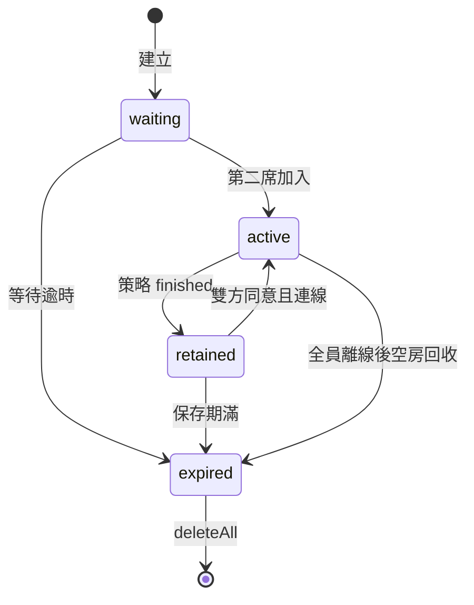

# 架構與保密資料流

2026-09-12。採用使用者修正後的同步 C-2、SoloGame DO、離線第二手表、八碼房間、再戰及後連分頁接管。已授權直接完成全部階段。

## 資料流

Vite + 原生 TypeScript / CSS 的 UI 只匯入公開 DTO type，不做評分或 solver。build plugin 遇到 core／server 模組進入 client bundle 會直接失敗。Static Assets 只提供 `dist/client`，因此原始碼、5040 報告、測試、secret 都不在公開目錄。

全部輸入由伺服端重新驗證：四位 ASCII 數字且互不重複，允許前導 0；不 trim、不轉全形；A/B 必須非負整數且和 ≤4，另拒絕不可能的 3A1B。HTTP body 最多 8 KiB。不合法或矛盾回饋不增加步數。

## 單人權威狀態

HMAC token 可讀、不能保密；AES-GCM 雖能保密，無狀態 token 仍可重播／分叉，無法強制限制次數。採每局一個 SQLite SoloGame DO，避免 KV 最終一致性影響並行動作。第一版不需 D1 或其他服務。

單一資料列保存 snapshot 與獨立 BLOB 欄位 `candidates`：5040 bits = 630 bytes。一次有效動作收斂為一次 UPDATE；無效或已重送動作不寫遊戲列。SQLite 主鍵固定，沒有 mutable 索引或每候選一列。runtime 已檢查 rowsWritten=1；alarm 與清理不包含在此數字內。

`generation`、`expectedRevision`、requestId 收據一起保存，拒絕舊版本／分叉、支援同一請求重送。單人閒置 24 小時、finished 保留 30 分鐘。活動中只改資料列 expiresAt，現有 alarm 到時再重排，避免每手 setAlarm。

Mode A 保存秘密答案和完整歷程；B 誠實模式保存輸入答案、自動評分；口述模式無秘密答案，只保存一致回饋。修改第 n 手時保留 n 前歷史、重新計算第 n 手，移除其後歷程。

## 共用房間與策略

`GameRoom.ts`／`host.ts` 負責身分、席位、連線 epoch、revision、requestId、SQLite 交易、alarm、回收、廣播與再戰。共用層不判斷玩法種類。`registry.ts` 將玩法名稱映射至 `GameStrategy`。

策略介面：`start(previous, context)`、`act(state, seat, action, context)`、`presence(...)`、`expire(...)`、`project(...)`。策略接收注入的時鐘、亂數和連線狀態，回傳新局面與最近 deadline；不讀 DB 或發送網路。新增玩法實作策略並註冊，不修改共用回合判斷。

每次再戰建立新的 gameId、清空回饋與意願，保留房間 incarnation、匿名身分、席位及連線 epoch。舊 gameId 動作拒絕；C-1 交換先手、重新輸入答案，C-2 重新亂數抽取（可能恰好與上一局相同，不刻意縮小答案空間）。

## C-1

策略 phase 為 setup／playing／finished。setup 先各自鎖定答案，初局隨機先手；playing 以 first、turn、round 控制。

先手第 n 回合命中，仍轉交後手第 n 回合；後手也中為和局，未中則先手勝。先手未中而後手命中，後手直接勝。非當前玩家的猜測拒絕。對手猜的是自己的答案，因此雙方可看對手完整猜測與回饋，但秘密答案欄位仍僅在 finished 出現。

## C-2

playing 每輪收兩個 pending；第一人提交後只回鎖定狀態，**連自己都沒有 A/B 回饋**。第二人提交時在同一交易評分並追加兩份歷程：單中勝、雙中和局、都未中進下一輪。沒有 settlement_wait 或補猜。

每輪 60 秒，不因重連／單方送出延長；任何動作先以伺服端時間處理 deadline，到期或之後到達均不能補送。單方未提交判負、雙方都未提交取消。前者把已提交手寫入 finished 歷程並標示 incomplete。

每位玩家只能看自己的內容、回饋及對手已提交步數（已結算歷程長度 + 本輪是否已提交）。進行中 `revealOpponentHistory=false` 不輸出 opponentHistory 欄位。若管理者日後設 true，也只公開已結算輪，不公開 pending。**finished 一律公開雙方歷程與答案，旗標不再限制。**

## 身分、分享與順序

匿名身分使用 HMAC 簽署的 `__Host-1a2b-session` HttpOnly、Secure、SameSite=Strict Cookie。答案和玩家身分憑證不進 URL／localStorage。前端只保留局 ID／房碼；密鑰、答案和 raw 私有局面不寫 log，API no-store。

八碼字母表 `23456789ABCDEFGHJKMNPQRSTUVWXYZ`，31^8 種（約 39.63 bits）。HMAC 輸出經 rejection sampling 產生，原子建立時撞碼最多重試八次，不覆寫。短碼加入不建立房間資料，房滿拒絕。join 工程預設每身分 5 次／分鐘、每 IP 20 次／分鐘；IP 只用 HMAC 限流 key。

分享使用 256-bit HMAC 長 token，URL fragment 讀取後立即清除，再 POST 提交；DB 只存 token 雜湊。已加入的成員可透過 `/invite` 取得分享 token，避免重新整理後退化成短連結。token 只用加入，不可取代 Cookie 奪取席位；短碼仍可獨立加入。

同身分重連原子增加 connection epoch，後連直接接管，舊 socket 收到 replaced 後關閉。舊 epoch HTTP 動作拒絕；舊 socket close 不會把新連線標成離線。無唯讀／手動接管 UI。

序列以 DO 交易實際處理順序為準，不使用客戶端時間；每次提交更新 revision。C-2 兩方先後抵達不影響同輪結局；同一席多次提交只接受第一個合法動作，重送 requestId 不計第二次。

## Hibernation 與期限

Worker 完成認證後以 DO `fetch` 轉送內部 WebSocket upgrade；不使用 RPC 回傳 WebSocket（runtime 不支援該物件序列化）。DO 呼叫 `ctx.acceptWebSocket`，attachment 只存身分、incarnation、epoch、訊息限流。`ping`／`pong` 用 `setWebSocketAutoResponse`，不為心跳喚醒 handler。

`webSocketMessage(ws, string|ArrayBuffer)` 僅接受小型 sync；`webSocketClose(ws, code, reason, wasClean)`／error 更新連線。constructor 不依賴記憶體局面，事件讀 SQLite；workerd 已驗證 eviction 後保留 pending 並由 WebSocket 喚醒。

單一 alarm 選共用回收和策略 deadline 的最早值。deleteAll 在 blockConcurrencyWhile 內執行、不放 SQLite transaction。等待室 10 分鐘；空房全員離線 60 秒回收；C-1 setup 5 分鐘、每手 120 秒、離線寬限 60 秒；C-2 每輪 60 秒；結果保留 30 分鐘。除指定 C-2 60 秒外都是工程預設。

## Solver 與效能

首手固定 0123；14 項表包含 13 個第二手和 4A0B 終止項目。離線 script 對每個首手結果執行完整 candidate-only minimax，測試比對靜態表與即時計算。第三手起完整搜尋候選集合，最壞分桶數最小優先；全部猜測均在候選集合，平手再取字典序。剪枝僅略過已不可能勝出的分支，仍是 exact。

候選 bitset 做完整歷史交集。空集合回報矛盾，保留舊狀態；診斷盡可能取得 irreducible conflict subset，不保證全域最小。每次非命中必排除本次候選，集合嚴格縮小，避免無窮迴圈。

全部 5040 答案實測平均 5.3537698413 步、最壞 8；首手後最多 1440、第二手後最多 378。時序數據與環境見 `reports/solver-summary.json`，不得當作正式 CPU／網路保證。

## 官方設定依據

2026-09-12 查閱官方文件並核對 Wrangler 4.131.1 schema、dry-run、workerd。使用 declarative `exports` 的 SQLite DO 設定，**不與 legacy migrations 混用**；設定檔就是可部署版本，部署結果另記錄。

- [Wrangler configuration](https://developers.cloudflare.com/workers/wrangler/configuration/)
- [DO class exports](https://developers.cloudflare.com/durable-objects/reference/durable-objects-migrations/)
- [Static Assets binding](https://developers.cloudflare.com/workers/static-assets/binding/)
- [WebSocket Hibernation](https://developers.cloudflare.com/durable-objects/best-practices/websockets/)
- [DO limits](https://developers.cloudflare.com/durable-objects/platform/limits/)：目前預設 DO CPU 30 秒／呼叫；與本專案 300ms 運算目標不同。
- [DO pricing](https://developers.cloudflare.com/durable-objects/platform/pricing/)：每日 rows 配額、alarm／刪除等須分開考慮，不將一次 UPDATE 宣稱為動作全部費用。

